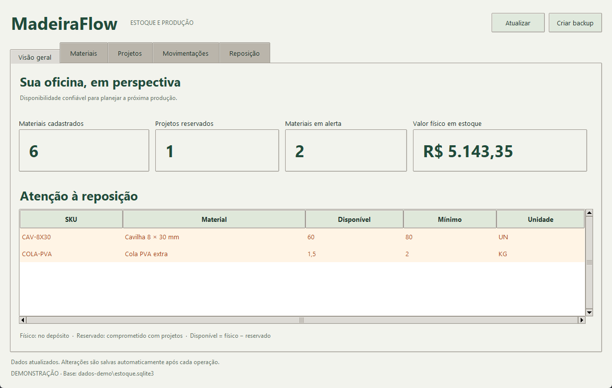

# madeira-flow

Estoque e produção para marcenaria de móveis planejados. Separa físico, reservado e disponível; permite receber materiais, conferir inventário, planejar projetos, reservar, consumir e cancelar. Aplicação desktop com Python, Tkinter, SQLite e biblioteca padrão.

O projeto e o repositório usam o nome `madeira-flow`. O pacote Python é `madeiraflow`. Para publicar o projeto por módulos, siga a [sequência de 30 commits](SEQUENCIA_COMMITS.md), com os arquivos e comandos de cada etapa.



## Executar no Windows

Instale **Python 3.11 ou superior com Tcl/Tk**, disponível no instalador oficial para Windows. Não há pacotes externos para executar ou testar. A execução local foi verificada com Python 3.14.2.

1. Abra **`demo.bat`** para usar exemplos em base separada.
2. Abra **`run.bat`** para começar com estoque vazio.
3. Execute **`test.bat`** para verificar regras e persistência.

Os lançadores procuram um Python instalado e entram na pasta do projeto. `dist/MadeiraFlow.pyz` é o aplicativo pronto; exige Python/Tk e não é um `.exe` independente.

```powershell
python -m madeiraflow --demo
python app.py --demo
python -m madeiraflow --demo --data dados-demo/ensaio-02.sqlite3
python -m madeiraflow --demo --verificar
python -m madeiraflow --data dados/estoque.sqlite3 --backup backups/estoque-01.sqlite3
python scripts/verificar.py

# Inclui os sete testes de widgets/callbacks em uma sessão gráfica:
$env:RUN_GUI_TESTS='1'
python scripts/verificar.py

# Aplicativo e ZIP de entrega:
python scripts/empacotar.py
python dist/MadeiraFlow.pyz --demo
```

Se `python` abrir a Microsoft Store, use os `.bat`, `py -3` se instalado ou o caminho completo do interpretador. Linux/macOS: use `python3`. Linux pode exigir o pacote do sistema `python3-tk`; testes sem interface e `--verificar` dispensam Tk. CI preparado para Windows/Linux e Python 3.11/3.14; a evidência local é Windows/Python 3.14.2.

## Usar a interface

- **Visão geral:** materiais, projetos reservados, alertas e valor físico. Quantidades de unidades distintas nunca são somadas.
- **Materiais:** cadastro de chapa/insumo, busca, edição, exclusão protegida, recebimento com custo/referência e inventário justificado. Dimensões em mm apenas para CHAPA. Saldo não é editado no cadastro.
- **Projetos:** informe nome/cliente e adicione itens. Apenas PLANEJADO permite edição. Reservar compromete todos os itens; concluir consome a reserva; cancelar libera o compromisso.
- **Movimentações:** entradas, reservas, liberações, consumos, ajustes e auditoria, em ordem inversa de registro.
- **Reposição:** escolha compra até o mínimo ou até o alvo. Estimativas usam disponível e custo médio; não criam pedidos.

Use `12,5` ou `12.5`, sem milhares. Ponto sempre é decimal: `1.000` significa uma unidade. CHAPA/UN exigem inteiros; M/L/KG admitem três casas. Custo de recebimento é positivo com até duas casas; custo médio usa quatro casas HALF_UP.

## Configuração e dados

| Opção | Resultado |
|---|---|
| Sem argumentos | Base vazia em `dados/estoque.sqlite3` |
| `--demo` | Base em `dados-demo/estoque.sqlite3`, populada somente se o arquivo for novo |
| `--data caminho` | Escolhe banco e cria diretório pai |
| `--verificar` | Valida banco, informa contagens e sai sem interface |
| `--backup caminho` | Cria cópia consistente em arquivo novo e sai |
| `--help` | Ajuda |

Caminhos relativos usam a pasta de trabalho; os `.bat` entram na pasta do projeto. A interface salva automaticamente cada operação. **Criar backup** permite copiar base aberta; restaure abrindo a cópia com `--data`. Backup não sobrescreve arquivos existentes.

SQLite armazena snapshot JSON versionado, decimais como texto e revisão para impedir sobrescrita por gravação antiga. Domínio, movimentos, alertas e auditoria são confirmados na mesma transação. Falha de regra, observador ou escrita impede o commit. Em conflito entre instâncias, atualize e tente novamente; comandos não são repetidos automaticamente.

Arquivo inválido, arquivo vazio existente e versão desconhecida são recusados sem reinicialização. Limite: 32 MB de conteúdo JSON; leitura/escrita percorrem a base. Uso local de pequeno porte, sem arquivo compartilhado por rede.

## Demonstração

Seis materiais e dois projetos: Cozinha Aurora RESERVADO e Armário Ipê PLANEJADO. Cavilhas: físico 150, reservado 90, disponível 60, mínimo 80, alvo 400. Mínima sugere 20; alvo, 340. Cola: disponível 1,5 kg, mínimo 2, alvo 10. Os exemplos passam pelos mesmos serviços da interface e são gravados integralmente.

Novo ensaio sem apagar o anterior: `python -m madeiraflow --demo --data dados-demo/ensaio-03.sqlite3`.

## Documentação e entrega

- [Documento técnico](docs/documento-tecnico.pdf) e capítulos editáveis `docs/01-*.md` a `06-*.md`.
- [Modelos UML](docs/modelos-uml.pdf), [índice offline](docs/uml/index.html), fontes PlantUML e SVG em `docs/uml/`.
- [Apresentação PDF](docs/apresentacao.pdf), [slides HTML offline](docs/apresentacao.html), [roteiro](docs/07-apresentacao-e-demo.md).
- [Resultados dos testes](docs/evidencias/testes.txt), capturas e `.github/workflows/ci.yml`.
- [Autoria](docs/autoria.json)

Regeneração opcional: `python -m pip install -r requirements-docs.txt` e `python scripts/gerar_documentacao.py`. `python scripts/capturar_interface.py` captura as abas no Windows com sessão gráfica. Essas ferramentas não são dependências do aplicativo.


## Organização, testes e histórico

```text
madeiraflow/
  dominio/         entidades, invariantes e políticas
  aplicacao/       serviços, transações, contratos e eventos
  infraestrutura/ SQLite, memória, codec e demonstração
  interface/       janelas e formulários Tkinter
  composicao.py    montagem de dependências
  __main__.py      configuração e entrada CLI
tests/             regras, persistência, arquitetura, CLI e widgets
docs/              análise, UML, apresentação e evidências
scripts/           execução, testes, documentação e pacote
```

São 70 testes: 63 de regras/integração/arquitetura/CLI e sete gráficos. Sem `RUN_GUI_TESTS=1`, os gráficos aparecem como ignorados. O relatório de entrega registra a execução completa. CI preparado; nenhuma execução remota é afirmada.

O ZIP `dist/MadeiraFlow-Python-entrega.zip` inclui fontes, documentos, `.pyz`, manifesto SHA-256 e `dist/historico.bundle`. Após extrair, restaure o histórico com `git clone dist/historico.bundle madeira-flow`. Para iniciar o histórico da sequência de commits proposta, siga o roteiro acima. Não há publicação remota.

Limites: sem plano de corte, retalhos, financeiro, fiscal, autenticação, múltiplos depósitos, devolução ou consumo parcial. Projetos concluem integralmente.
